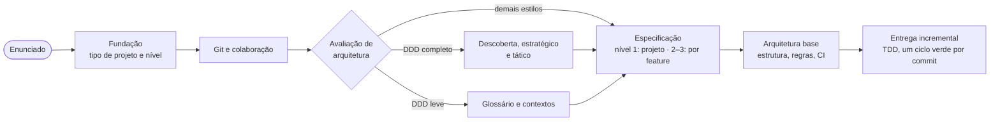

# sdd-method

Plugin do Claude Code com um método de projeto que serve para qualquer linguagem e qualquer tamanho de projeto. A
espinha é sempre a mesma: **SDD + TDD**, convenção de Git escrita e README com diagramas Mermaid. A arquitetura é
proporcional ao problema: o plugin avalia o projeto e recomenda o menor estilo que resolve as fronteiras reais, de
código simples a DDD completo, registrando também o que não vale a pena adotar.

Nasceu do Workshop Management System (FIAP SOAT, DDD completo) e dos projetos menores em que a arquitetura foi escolhida
sob medida (`anticipation-engine`, `customer_lookup`, `whatsapp-ai-agent`, `emporio-atendimento-agent` e um plugin
Twilio Flex entregue a um cliente).

## Instalação

### Requisitos

- [Claude Code](https://docs.claude.com/en/docs/claude-code) instalado (`claude --version`).
- `git` no PATH.
- Python 3, só para os scripts da auditoria de coerência (opcional).

### Instalar

```bash
claude plugin marketplace add Drolpg/claude-sdd-method
claude plugin install sdd-method@drolpg-methods
claude plugin list        # deve mostrar: sdd-method 0.x.y · Scope: user · ✔ enabled
```

Abra uma sessão nova do Claude Code depois de instalar: o plugin só é carregado no início da sessão.

O plugin fica no escopo do usuário, ou seja, vale para todos os projetos daquela máquina. Cada instalação do Claude
Code é independente: **Windows, WSL e cada outra máquina precisam da própria instalação**, com os mesmos comandos.

### Se o repositório estiver privado

O `marketplace add` clona o repositório com o git da máquina, então ela precisa de login no GitHub com acesso de
leitura. Pelo GitHub CLI:

```bash
gh auth login             # GitHub.com → HTTPS → login pelo navegador
gh auth setup-git         # faz o git usar esse login
```

No Windows, o Git Credential Manager do Git for Windows também serve (abre o login no navegador no primeiro acesso).
Sem login, o comando fica parado esperando usuário e senha.

### Atualizar, desativar e remover

```bash
claude plugin update sdd-method@drolpg-methods      # depois de cada versão nova publicada
claude plugin disable sdd-method@drolpg-methods     # desliga sem desinstalar
claude plugin uninstall sdd-method@drolpg-methods
```

Rode o `update` em cada ambiente onde o plugin estiver instalado.

### Ligar o plugin a um projeto

Para que um projeto use sempre o método, inclusive para quem clonar o repositório, faça commit deste
`.claude/settings.json` no projeto:

```json
{
  "extraKnownMarketplaces": {
    "drolpg-methods": {
      "source": { "source": "github", "repo": "Drolpg/claude-sdd-method" }
    }
  },
  "enabledPlugins": {
    "sdd-method@drolpg-methods": true
  }
}
```

Quem abrir o projeto no Claude Code e confiar na pasta recebe o pedido para instalar o plugin.

### Instalar a partir de uma cópia local

Para desenvolver o próprio plugin, aponte o marketplace para a pasta clonada:

```bash
git clone https://github.com/Drolpg/claude-sdd-method.git
claude plugin marketplace add ./claude-sdd-method
claude plugin install sdd-method@drolpg-methods
```

Nesse caso, a instalação segue a pasta: depois de `git pull`, rode `claude plugin update`.

## Como usar

Num projeto novo, só com o enunciado em mãos, diga ao Claude algo como *"vamos começar este projeto com o método"* ou
chame `/sdd-method:guiding-projects`. Ele conduz a fundação, define o padrão de Git, avalia a arquitetura e segue rito a
rito, sempre parando para a sua aprovação.

A qualquer momento: *"onde estamos?"*, *"que arquitetura usar?"*, *"o que falta para a entrega?"*.

## Dois eixos



| Nível de processo | Para | SDD |
|---|---|---|
| 1 — Enxuto | Solo, POC, desafio técnico, entrega fechada para cliente | Constituição → spec → plano → tarefas |
| 2 — Padrão | Grupo, projeto em fases, MVP | Por feature, com gates de aprovação |
| 3 — Completo | Produto contínuo, time maior, domínio regulado | Por feature + regras por épico, threat model, runbooks |

Estilos de arquitetura avaliados: código simples, camadas, camadas + ports nas fronteiras, núcleo funcional + casca,
hexagonal, Clean Architecture, fatias verticais, monólito modular, DDD leve, DDD completo.

## Skills

| Skill | Para |
|---|---|
| `guiding-projects` | Entrada: onde o projeto está e qual o próximo rito |
| `kicking-off-projects` | Fundação: enunciado, tipo de projeto, nível, `docs/method.md`, `AGENTS.md`, `CLAUDE.md` |
| `defining-git-workflow` | Branches, Conventional Commits, PR (time ou solo), `CONTRIBUTING.md` |
| `choosing-architecture` | Avaliação de arquitetura, catálogo de estilos, tipos de projeto, gatilhos para subir ou descer de nível |
| `running-domain-discovery` | Domain Storytelling e Event Storming (trilha DDD completo) |
| `designing-strategic-model` | Contextos, context map e linguagem ubíqua (DDD leve ou completo) |
| `designing-aggregates` | Aggregates, invariantes, estados, eventos e policies (DDD completo) |
| `specifying-projects` | SDD de projeto: constituição, spec com matriz requisito → teste, plano, tarefas (nível 1) |
| `refining-requirements` | Registro de requisitos e épicos (níveis 2–3) |
| `specifying-features` | SDD por feature com gates (níveis 2–3) |
| `establishing-architecture` | Stack, estrutura do estilo, regras de dependência automatizadas, CI |
| `driving-with-tests` | TDD, camadas de teste, evals de IA, relatório de tarefa |
| `recording-decisions` | Decisões e débitos: tabelas no plano (nível 1) ou AD, ADR, RFC, TD |
| `reviewing-security` | Checklist por tarefa/feature e relatório de vulnerabilidades por fase |
| `documenting-delivery` | README com diagramas Mermaid, guias, anexos de entrega para cliente, roteiro de demo |
| `auditing-coherence` | Cruzamento entre spec, testes, decisões, board, README, Git e código |

Agente incluído: `architecture-reviewer`, que revisa mudanças contra a decisão de estilo e as regras do projeto
(contradição, excesso de estrutura, falta de estrutura), sem alterar nada.

## Projetos de referência

Mapeados em `plugins/sdd-method/skills/guiding-projects/reference-projects.md`, com o que cada um exemplifica.

## Como evoluir o método

1. Quando, num projeto, faltar um template, um rito ficar pesado demais ou uma regra se mostrar errada, peça ao Claude
   para propor a mudança aqui, explicando o caso real.
2. Registre no `CHANGELOG.md` e suba a versão em `plugins/sdd-method/.claude-plugin/plugin.json` e em
   `.claude-plugin/marketplace.json` (correção = patch, template ou rito novo = minor, mudança de gate = major).
3. Valide com `claude plugin validate plugins/sdd-method` e atualize com `claude plugin update sdd-method@drolpg-methods`.

Linguagem nova entra como coluna em `skills/establishing-architecture/stack-profiles.md`; estilo novo, em
`skills/choosing-architecture/architecture-styles.md`; tipo de projeto novo, em `project-archetypes.md`.
