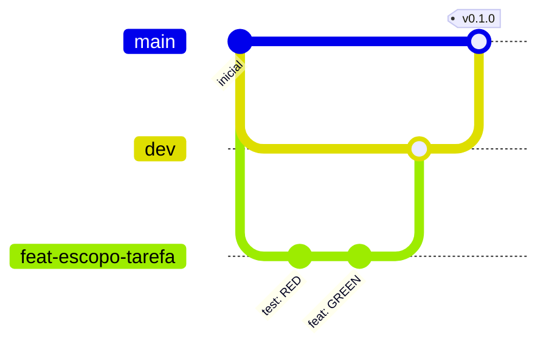

# Como contribuir

Vale para pessoas e agentes. O método do projeto está em `docs/method.md`; as regras de código, em `AGENTS.md`.

## Fluxo de trabalho

1. A mudança começa na spec (`docs/01-spec.md` ou `docs/features/…`), nunca no código.
2. Uma tarefa por vez, com TDD: teste falhando → código mínimo → refatoração → suíte completa verde.
3. Um ciclo verde = um commit.

## Branches

Modelo: `<só main · main + dev · main + dev com PR>`

- `main`: `<só recebe merge com autorização explícita; cada merge é uma versão demonstrável>`.
- `dev`: `<branch de integração; toda feature nasce dela e volta para ela depois do checkpoint>`.
- Nome: `<tipo>/<escopo>-<descricao-curta>`, tudo minúsculo. Ex.: `feat/consultas-listagem-paginada`.



## Commits

Formato [Conventional Commits](https://www.conventionalcommits.org/pt-br/v1.0.0/):

```text
<tipo>(<escopo>): <assunto>

<corpo opcional: o quê e por quê, não como>

Refs: RF-NN
```

| Parâmetro | Regra |
|---|---|
| Tipos | `feat`, `fix`, `refactor`, `perf`, `test`, `docs`, `build`, `ci`, `chore`, `style`, `revert` |
| Escopos | `<módulos/contextos/fases do projeto>`, `platform`, `deps`, `readme` — `<obrigatório · opcional>` |
| Assunto | `<português>`, imperativo, minúsculo, sem ponto final, até 72 caracteres |
| Corpo | Quebra em 72–100 colunas; explica o porquê |
| Rodapé | `Refs: RF-NN` quando houver requisito; `BREAKING CHANGE: …` quando quebrar contrato |
| Trailers de IA | `<Não usar (sem Co-Authored-By de assistente) · Permitidos>` |

Exemplos:

```text
test(consultas): cobrir rejeição de documento com dígito verificador inválido
feat(consultas): rejeitar documento com dígito verificador inválido
fix(worker): não sobrescrever estado final em reprocessamento
docs(readme): adicionar diagrama de sequência do processamento
```

## Pull requests

- Template: `.github/pull_request_template.md`.
- `<Time: ao menos uma revisão aprovada antes do merge. · Solo: checklist de auto-revisão conferida antes do merge.>`
- Título do PR no mesmo formato de commit.
- Merge: `<squash · merge commit>`; a branch é apagada depois.

## Versões

Tag SemVer na `main` a cada entrega (`v<major>.<minor>.<patch>`), com as mudanças no `CHANGELOG.md` quando houver.

## Nunca

- Commitar segredos, `.env`, credenciais ou dados pessoais reais.
- Alterar testes ou a spec só para o build passar.
- Fazer push ou merge na `main` sem autorização.
- Commitar `docs/_local/` (notas e histórico bruto, fora do git).
