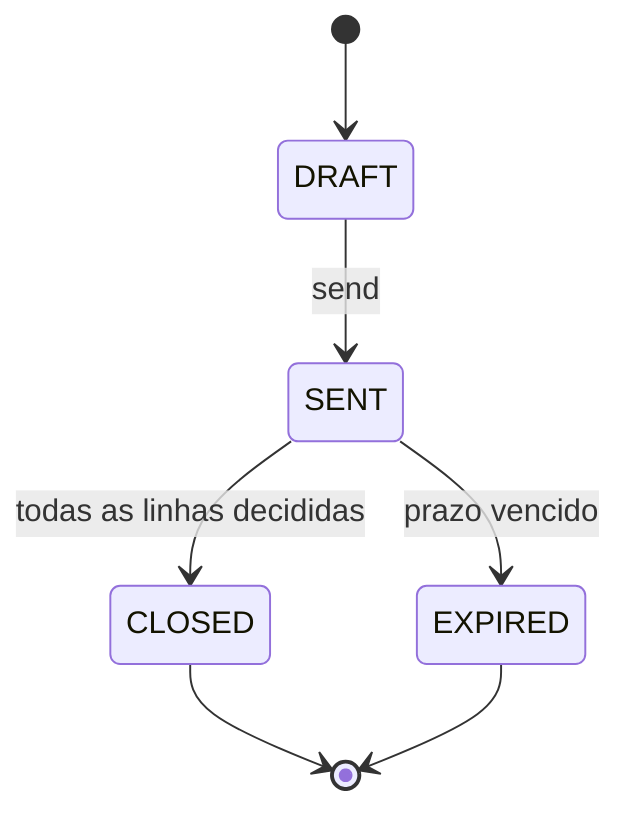

# Aggregate: <Nome>

| Campo | Valor |
|---|---|
| Bounded context | `<contexto>` |
| Status | Draft |
| Atualizado em | `<AAAA-MM-DD>` |
| Aprovado por / em | — |
| Origem | `<frames do Event Storming, hotspots>` |

## 1. Propósito

`<Que decisão de negócio este aggregate protege. Uma ou duas frases.>`

## 2. Ciclo de vida

## 3. Comandos aceitos

| Comando | Ator | Pré-condições | Eventos emitidos | Falhas de negócio |
|---|---|---|---|---|
| `<send>` | `<Service Advisor>` | `<status = DRAFT>` | `<EstimateSent>` | `<ESTIMATE_NOT_DRAFT>` |

## 4. Invariantes

| ID | Regra | Como é garantida | Teste |
|---|---|---|---|
| INV-01 | `<regra verificável>` | `<no método X, antes de mudar o estado>` | `<nome do teste, preenchido no rito 8>` |

## 5. Policies corretivas

O que acontece quando uma regra só pode ser verificada depois (consistência eventual).

| Situação | Policy | Responsável |
|---|---|---|

## 6. Composição

| Elemento | Tipo | Observação |
|---|---|---|
| `<EstimateLine>` | `<Entity · Value Object>` | `<identidade local, imutável…>` |

## 7. Referências e snapshots

| Referência | Contexto de origem | Por ID? | Snapshot (campos e quando congela) |
|---|---|---|---|
| `<customerId>` | `<Registrations>` | Sim | `<nome e documento, na abertura>` |

## 8. Volume e concorrência

- Vazão esperada: `<ex.: dezenas por dia>`.
- Conflitos prováveis: `<ex.: duas decisões simultâneas na mesma linha>`.
- Estratégia: `<lock otimista por versão · comando idempotente · …>`.

## 9. Casos de borda fechados

| Pergunta | Decisão | Data | Quem decidiu |
|---|---|---|---|

## 10. Perguntas em aberto

- `<pergunta>` → `<AD-NNN · RFC-NNN · hotspot H-NN>`
