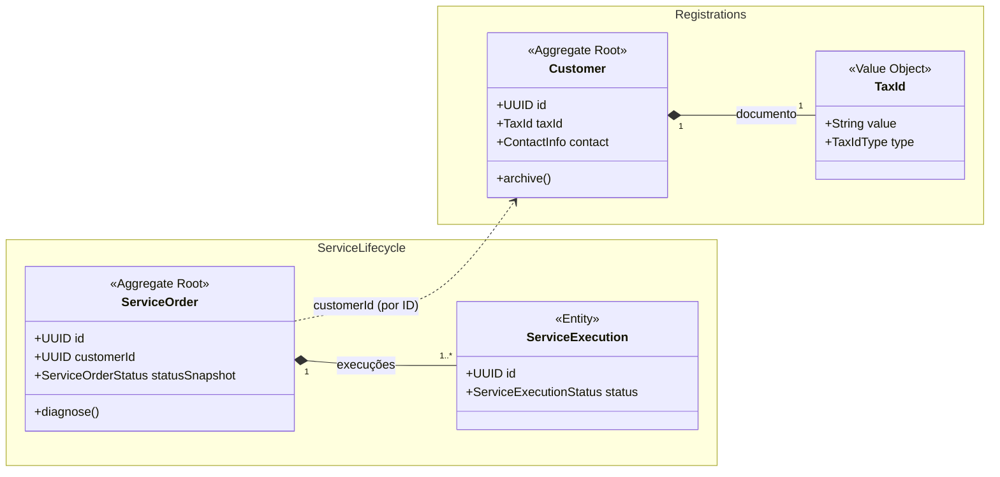

# Modelo de domínio

| Campo | Valor |
|---|---|
| Status | Draft |
| Atualizado em | `<AAAA-MM-DD>` |
| Aprovado por / em | — |
| Auditado contra o código em | `<AAAA-MM-DD · "ainda não implementado">` |

Antes da implementação, este diagrama é o alvo. Depois, o código é a fonte da verdade e o diagrama é auditado contra
ele a cada fase.

<!-- Substitua o exemplo. Convenções:
- um namespace por bounded context;
- estereótipos: <<Aggregate Root>>, <<Entity>>, <<Value Object>>, <<enumeration>>, <<Domain Event>>;
- composição (*--) só dentro do aggregate; entre aggregates, dependência tracejada (..>) com o nome do campo de ID;
- nomes iguais em contextos diferentes: use um alias e uma nota, ex.
  note for RegistrationMoney "Classe Money do pacote registration.catalog". -->

## Legenda

| Notação | Significado |
|---|---|
| `*--` | Faz parte do aggregate (mesma transação) |
| `..>` | Referência por ID a outro aggregate |
| `<<Value Object>>` | Imutável, validado na criação, sem identidade |

## Divergências conhecidas código × diagrama

| Elemento | Diagrama | Código | Motivo | Registro |
|---|---|---|---|---|
