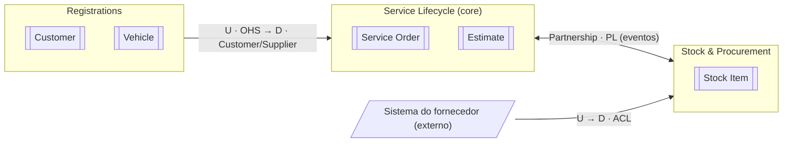

# Context map

| Campo | Valor |
|---|---|
| Status | Draft |
| Atualizado em | `<AAAA-MM-DD>` |
| Aprovado por / em | — |
| Materialização das integrações | `<ADR-NNN>` |
| Board | `<link do frame>` |

<!-- Substitua o exemplo pelos contextos do projeto. -->

## Relações

| Upstream | Downstream | Padrão | Contrato vigente | Decisão |
|---|---|---|---|---|
| `<contexto>` | `<contexto>` | `<OHS · PL · ACL · Partnership · …>` | `<API in-process · evento X · HTTP>` | `<ADR-NNN>` |

## Observações

- `<AAAA-MM-DD>`: `<mudança feita depois do workshop e por quê>`.
