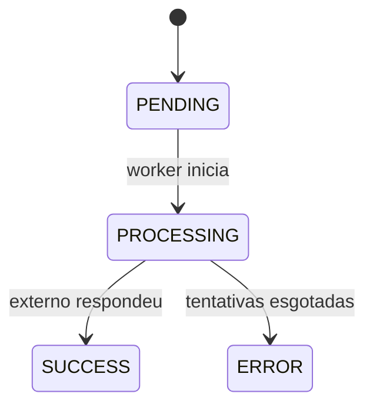
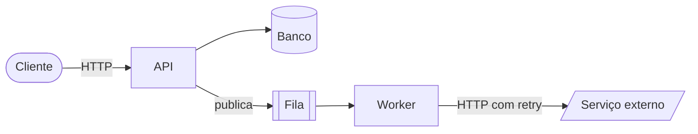
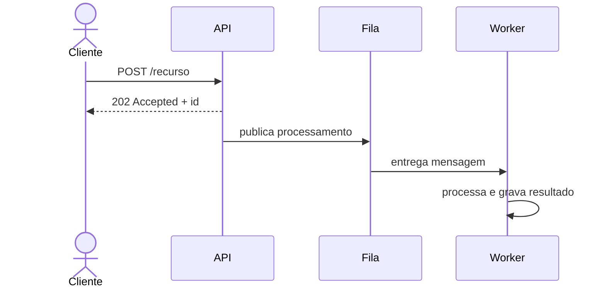
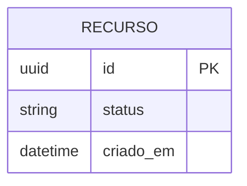

# <nome-do-projeto> — <o que é, em poucas palavras>

<Uma ou duas frases: o que o sistema faz, para quem e o diferencial.>

## Índice

- [O que é](#o-que-é)
- [Arquitetura](#arquitetura)
- [Como rodar](#como-rodar)
- [Exemplos de uso](#exemplos-de-uso)
- [Testes](#testes)
- [Decisões técnicas](#decisões-técnicas)
- [Débitos técnicos e evolução](#débitos-técnicos-e-evolução)
- [Estrutura do repositório](#estrutura-do-repositório)

## O que é

Problema, objetivo e escopo. Link para a spec (`docs/01-spec.md` ou `docs/requirements/`).

<!-- Se houver ciclo de vida, o diagrama de estados entra aqui. -->



## Arquitetura

Estilo: `<estilo>` — `<uma frase com o porquê; link para a decisão>`.

### Componentes



| Componente | Responsabilidade |
|---|---|

### Fluxo principal



<!-- Se houver persistência: -->

### Modelo de dados



## Como rodar

Pré-requisitos e comandos mínimos, com a saída esperada. Variáveis de ambiente principais em tabela; detalhes em
`docs/` quando houver.

```bash
<comando>
```

## Exemplos de uso

Requisições e respostas reais (ou conversas, para agentes), incluindo um caso de erro.

## Testes

```bash
<comando da suíte>
<comando de lint e tipos>
```

### O que é testado e por quê

| Camada | O que garante |
|---|---|

<!-- Agentes de IA: seção "Avaliação contra o provedor real" com resultado e "o que a avaliação encontrou que os
testes não pegavam". -->

## Decisões técnicas

| Decisão | Por quê | Alternativa descartada |
|---|---|---|

Detalhes em `docs/02-plan.md` ou `docs/adr/`.

## Débitos técnicos e evolução

| Débito ou melhoria | Impacto | Como resolver |
|---|---|---|

## Estrutura do repositório

```text
<árvore resumida, uma linha de descrição por pasta>
```

<!-- Opcional: "Uso de assistentes de código" — como o trabalho foi organizado, como foi revisado e validado, onde a
revisão mudou o resultado. -->
