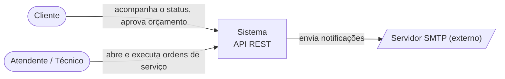
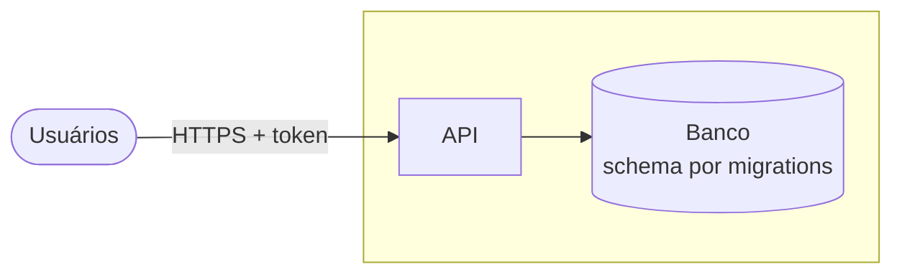
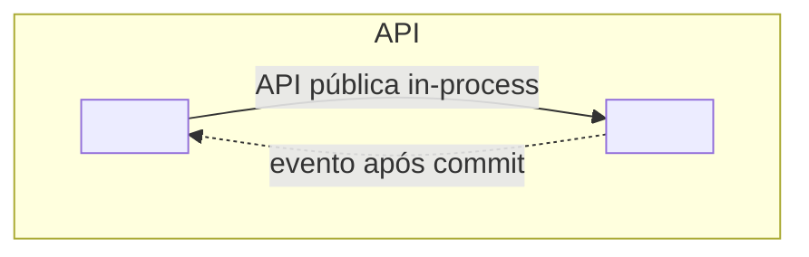
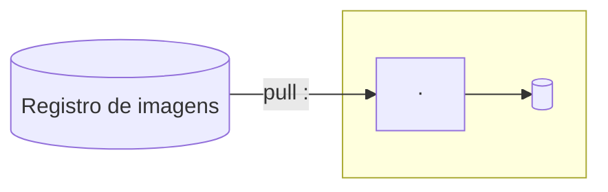

# Visão geral da arquitetura

| Campo | Valor |
|---|---|
| Atualizado em | `<AAAA-MM-DD>` |
| Decisões | `<ADRs de estrutura, stack, banco, ambientes>` |

## 1. Contexto (C4 nível 1)

Só entram pessoas e sistemas externos que têm requisito ou decisão por trás.

## 2. Containers (C4 nível 2)

| Container | Responsabilidade | Tecnologia | Decisão |
|---|---|---|---|

## 3. Componentes / módulos (C4 nível 3)

Nível 3 ou quando a divisão interna precisa ser explicada. Um bloco por módulo e as relações do context map.

## 4. Implantação

| Ambiente | Para que serve | Como é criado | Guia |
|---|---|---|---|

## 5. Decisões

| ADR | Decide |
|---|---|
