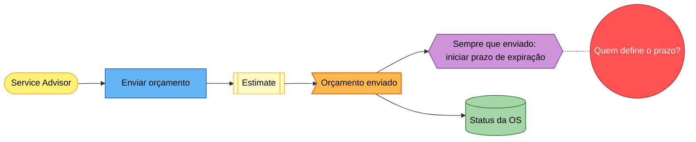

# Guia de Event Storming

## Legenda

| Elemento | Cor no board | Escrita | Exemplo |
|---|---|---|---|
| Evento de domínio | Laranja | Fato no passado | "Orçamento enviado" |
| Comando | Azul | Verbo no imperativo | "Enviar orçamento" |
| Ator | Amarelo (pequeno) | Papel, não pessoa | "Service Advisor" |
| Aggregate | Amarelo claro (grande) | Substantivo do domínio | "Estimate" |
| Policy | Lilás | "Sempre que X, então Y" | "Sempre que a linha for aprovada, reservar as peças" |
| Sistema externo | Rosa | Nome do sistema | "Sistema do fornecedor" |
| Read model | Verde | O que o ator vê | "Status da ordem de serviço" |
| Hotspot | Vermelho / magenta | Pergunta ou problema | "Quem decide quando o orçamento expira?" |

## Etapas

| Etapa | Pergunta que guia | Saída | Tempo sugerido (time) |
|---|---|---|---|
| Exploração caótica | "O que acontece neste negócio?" | Eventos soltos | 20–30 min |
| Linha do tempo | "O que vem antes e depois?" | Eventos ordenados, sinônimos unidos | 20 min |
| Hotspots | "Onde há dúvida, conflito ou dor?" | Hotspots com destino | 15 min |
| Eventos pivotais e raias | "Onde o processo muda de fase?" | Pivotais e raias | 15 min |
| Atores, comandos e policies | "O que causa este evento? O que reage a ele?" | Cadeias comando → evento → policy | 30–45 min |
| Read models e sistemas externos | "O que o ator precisa ver? Quem fora do sistema participa?" | Read models, externos | 15 min |
| Aggregates candidatos | "O que garante esta regra?" | Agrupamentos | 20 min |

Big Picture cobre o negócio inteiro. Event Storming de processo (nível 3, ou num fluxo crítico) repete as etapas de
atores em diante para um único fluxo, com mais detalhe.

## Representação em Mermaid

Use um diagrama por fluxo, não um diagrama gigante.

## Representação em tabela (sem board)

| # | Evento | Ator | Comando | Aggregate candidato | Policy disparada | Read model | Hotspot |
|---|---|---|---|---|---|---|---|
| 1 | Orçamento enviado | Service Advisor | Enviar orçamento | Estimate | Iniciar prazo de expiração | Status da OS | H03 |
