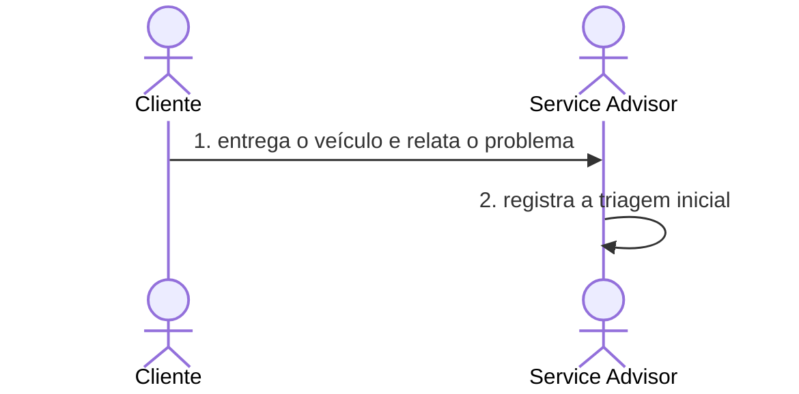

# Domain Storytelling: <processo>

| Campo | Valor |
|---|---|
| Status | Draft |
| Narrado por | `<pessoa do negócio ou usuário>` |
| Registrado em | `<AAAA-MM-DD>` |
| Board | `<link do frame ou "não usa">` |

## Escopo da história

| Dimensão | Escolha |
|---|---|
| Granularidade | `<grossa (processo inteiro) · fina (um fluxo)>` |
| Momento | `<as-is (como é hoje) · to-be (como será com o sistema)>` |
| Pureza | `<pura (sem sistema) · digitalizada (com o sistema)>` |

## Atores

| Ator | Quem é | Observação |
|---|---|---|

## Objetos de trabalho

| Objeto | O que é para o negócio |
|---|---|

## História 1 — <caminho feliz>

1. `<Ator>` `<atividade>` `<objeto>` `<para/com quem>`.
2. …

## História 2 — <exceção relevante>

1. …

## Termos novos

| Termo | Como o negócio usou | Vai para a linguagem ubíqua? |
|---|---|---|

## Perguntas que surgiram

- `<pergunta>` → hotspot `H<NN>`
