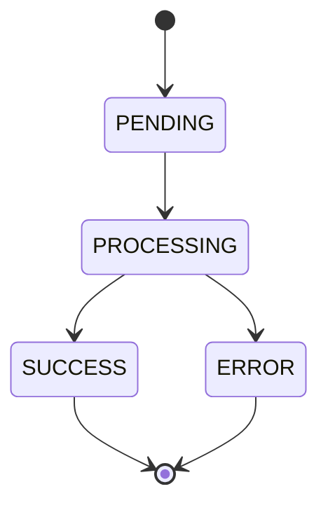

# 01 — Especificação

| Campo | Valor |
|---|---|
| Status | Draft |
| Atualizado em | `<AAAA-MM-DD>` |
| Aprovado por / em | — |
| Enunciado | `docs/challenge/phase-1.md` |

## 1. Contexto e objetivo

`<Problema, para quem, resultado esperado.>`

## 2. Atores

| Ator | Papel |
|---|---|

## 3. Glossário

| Termo | Significado | Nome no código |
|---|---|---|

## 4. Requisitos funcionais

| ID | Requisito | Critério de aceite |
|---|---|---|
| RF-01 | `<comportamento verificável>` | `<dado / quando / então>` |

## 5. Requisitos não funcionais

| ID | Requisito | Como verificar |
|---|---|---|
| RNF-01 | `<ex.: resposta em até 200 ms no p95 para criação>` | `<teste de carga X>` |

## 6. Contrato

`<Endpoints, mensagens ou eventos: entrada, saída, códigos de status.>`

### Estados

<!-- Remova se não houver ciclo de vida. -->

## 7. Erros

| Código | HTTP | Quando |
|---|---|---|
| `<VALIDATION_ERROR>` | 422 | `<payload inválido>` |

## 8. Casos de borda decididos

| Pergunta | Decisão | Data |
|---|---|---|

## 9. Fora de escopo

- `<item>` — `<por quê>`

## 10. Matriz de rastreabilidade

| Requisito | Teste(s) |
|---|---|
| RF-01 | `<tests/integration/test_x.py::test_y>` |

Todo requisito tem pelo menos um teste; todo teste aparece aqui.

## 11. Histórico da spec

| Data | Mudança | Motivo | Aprovado por |
|---|---|---|---|
