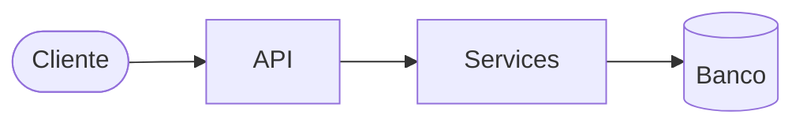

# 02 — Plano técnico

| Campo | Valor |
|---|---|
| Status | Draft |
| Atualizado em | `<AAAA-MM-DD>` |
| Aprovado por / em | — |
| Spec | `docs/01-spec.md` (aprovada em `<AAAA-MM-DD>`) |

## 1. Decisão de arquitetura

**Estilo:** `<estilo>` — avaliação completa em `<link ou anexo>`.

| Elemento estrutural | Sinal que justifica |
|---|---|

**O que não será adotado:**

| Elemento | Motivo |
|---|---|

**Gatilhos para revisar:** `<quando X acontecer → adotar Y>`.



## 2. Estrutura de diretórios

```text
src/<pacote>/
  <estrutura do estilo escolhido>
tests/
  unit/  integration/  e2e/
```

## 3. Stack

`<Linguagem, framework, banco, fila, ferramentas de teste e qualidade — ou link para o perfil de stack.>`

## 4. Decisões que afetam o código

| ID | Decisão | Alternativas | Motivo |
|---|---|---|---|
| D01 | `<decisão>` | `<o que foi descartado>` | `<por quê>` |

Decisão que cruzar módulos, for revisitada ou precisar de discussão vira ADR em arquivo.

## 5. Estratégia de testes

| Camada | O que cobre | Dependências reais | Fakes |
|---|---|---|---|
| unit | `<regras puras, validações>` | nenhuma | — |
| integration | `<API + services + banco de teste>` | `<banco>` | `<fakes das ports>` |
| e2e | `<fluxo completo em containers>` | `<todas>` | — |

## 6. Pontos de atenção

- `<risco técnico e como o desenho o trata>`

## 7. Débitos técnicos intencionais

| Débito | Por que agora não | Impacto | Como pagar |
|---|---|---|---|
